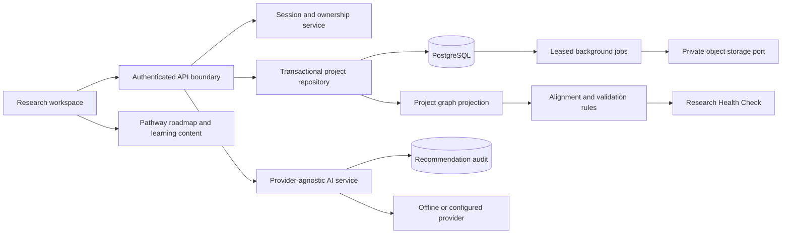
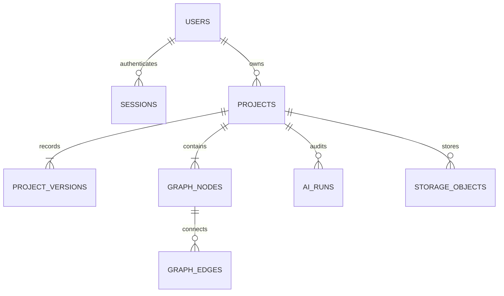

# ResearchForge architecture and evolution

## Runtime boundaries

Next.js serves the interface and JSON API as a modular monolith. This keeps the deployment and transactional boundaries manageable for v0.1. Pure domain functions have no React/database dependencies. Authentication, persistence, AI, storage and jobs have separate modules. Service extraction can happen later at workload boundaries, rather than prematurely splitting every engine into a service.

## Data model

`projects.document` is the v0.1 editable aggregate, validated by the version-1 schema. It contains stable question, objective and paper identifiers. `graph_nodes` and `graph_edges` materialize its connections for future graph consumers. `project_versions` preserves immutable aggregate snapshots and computed impact sets. These three representations are deliberately updated in the same transaction. Only the repository can write them; browser payloads never write arbitrary graph edges directly.

Graph node payloads have a schema version. Current kinds are topic, gap, question, objective, paper and methodology. Later engines can attach evidence, theories, hypotheses, constructs, instruments, protocols, datasets, analysis runs, findings, manuscript sections and submissions using the same project-scoped keys. v0.1 projection only replaces the kinds it owns. When later domains arrive, their authoritative node payloads should live in typed domain tables or validated graph payloads, with materialized views for screens; avoid adding unbounded blobs to the planner aggregate.

## Save transaction
1. Authenticate session, validate origin/body and validate the project schema.
2. Select the owner's project row `FOR UPDATE`.
3. Compare the client's revision to the locked revision. Reject with 409 if stale.
4. Compare canonical JSON, ignoring PostgreSQL JSONB key order. Identical state produces no new revision.
5. Compute changed graph objects and traverse downstream dependencies in old and new graphs.
6. Update aggregate and revision, synchronize owned graph nodes/edges, insert snapshot/impact/actor/reason.
7. Commit; return the new revision and impact notice.

Autosave serializes requests within a browser. Failed saves remain visibly unsaved. Conflict recovery offers draft download and explicit reload. Restore uses the client's known revision and creates a new snapshot. It must never fetch the latest revision simply to force a stale write through.

## Engine contracts
| Engine | v0.1 input/output | Extension boundary |
|---|---|---|
| Project Graph | validated project → typed nodes and directed relations | Add node schemas and migrations; retain project-scoped IDs |
| Evidence | manual paper records + explicit paper-to-gap links | Source metadata adapters, claim/evidence spans, support/contradiction relations; verified status requires provenance |
| Alignment | project → versioned findings with severity/node/action | Domain rule packs, applicability predicates and persisted expert dispositions |
| Learning | pathway + profile mode + current state → lessons/roadmap | Versioned content library, proficiency and institution-specific curricula |
| Publication | reserved graph kinds and retained research history | Evidence-linked manuscript blocks, reporting packs, journal/submission/reviewer workflows |

Adaptive pathways are quantitative, qualitative, systematic review, machine learning and mixed methods. The selected pathway changes fields, completion logic and rule applicability; no arbitrary score is presented as research quality. Reporting standards are more granular than pathways, so later rule packs must match an actual study design and discipline. Ethics preparation is included from v0.1 and never labeled approval.

## AI request lifecycle
The user saves the project and requests suggestions. The service checks consent for external providers, rate limits the user, constructs a restricted context and inserts a pending audit record. A versioned system prompt constrains recommendations; provider output passes an explicit schema. The run becomes completed or failed. The researcher accepts, rejects or modifies selected text. Accepted question text is added through the ordinary editable project workflow, retaining normal autosave and revision behavior. The audit records the final text even if that later save fails; an atomic audit-to-node acceptance operation is a future improvement.

No AI provider has direct database write tools. Source IDs in the audit mean “supplied as context,” not “verified supporting evidence.” Model output is not rendered as HTML. Offline guidance uses the same output contract and is visibly labeled as templates.

## Phased implementation backlog
| Release | Milestones | Release gate |
|---|---|---|
| 0.1 foundation | Auth/profile; PostgreSQL and local persistence; aggregate/graph/version repository | Cross-account access denied; sessions revoke; stale saves rejected |
| 0.1 planner | All planning screens; adaptive guidance; ethics preparation; search/archive/export | Browser journey survives reload; all five pathways have appropriate fields |
| 0.1 integrity | Rules/impacts/history; AI audit; storage/job ports; documentation | Regression tests and production build; PostgreSQL staging smoke test |
| 0.2 evidence | DOI metadata adapters; source versions; evidence spans; theory/construct/instrument graph | No source verified without provider provenance; claims expose support and contradiction |
| 0.2 protocols | Ethics workflows; locked protocol snapshot; deviations and decision log | Locked records cannot be rewritten; each deviation names reason/actor/time |
| 0.3 execution | Private dataset versions; sandboxed analysis workers; quantitative/qualitative/ML artifacts | Reproduce an output from source data/code/config/environment identifiers |
| 1.0 publication | Evidence-grounded manuscript; domain reporting packs; verified journal workflow; reviewer response | Submission pack reproducibly assembled; revisions trace to reviewer requests |
| Institutional | Membership/roles, supervisor approvals, SSO, tenancy, retention and audit administration | Tenant isolation tests; authorization matrix; privacy/security review |

No calendar estimate is asserted without a staffed team and acceptance review. Domain experts must review methodological rules and teaching content before broader release. Public-launch account recovery, verification, operational controls and accessibility review are separate from implementing the core planner.

## Tradeoffs to revisit
- Whole-document autosave is simple and atomic but creates larger snapshots. At scale, use per-node revisions, durable patches and compaction while retaining immutable protocol snapshots.
- A single owner keeps authorization auditable. Add memberships behind the central access service before enabling any sharing routes.
- A relational graph supports bounded project traversals and transactional joins. Consider a graph database only after measuring workloads that exceed this model.
- The current UI and API return the v0.1 graph projection. Later evidence/publication views must query and authorize the expanded stored graph, not just the planner aggregate.
- External AI transport has a timeout but no automatic retry, avoiding duplicate/costly generations. Background tasks use idempotency keys and must gain heartbeat renewal for work exceeding their lease.
